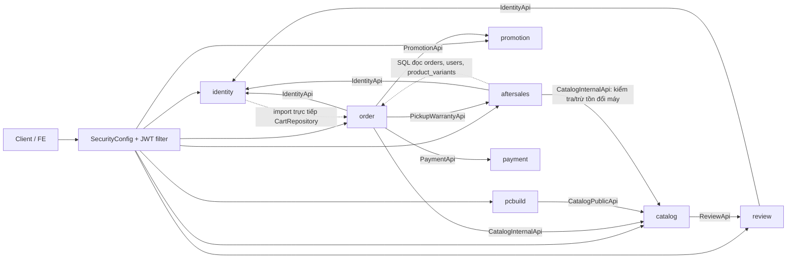
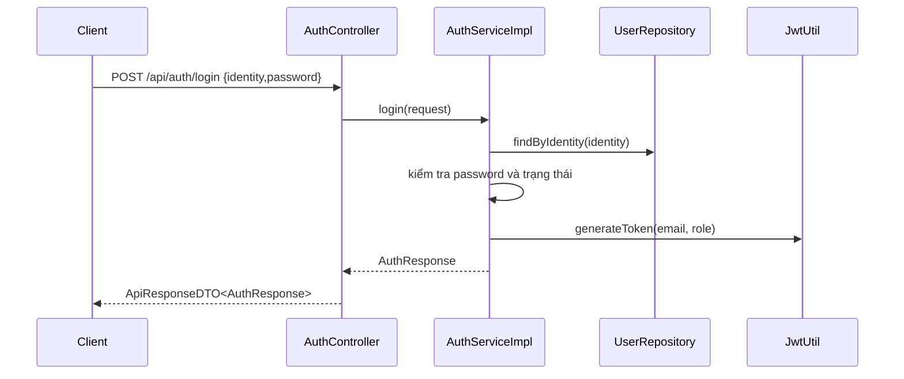
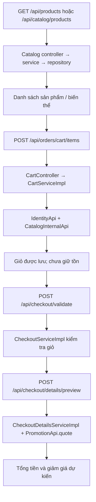
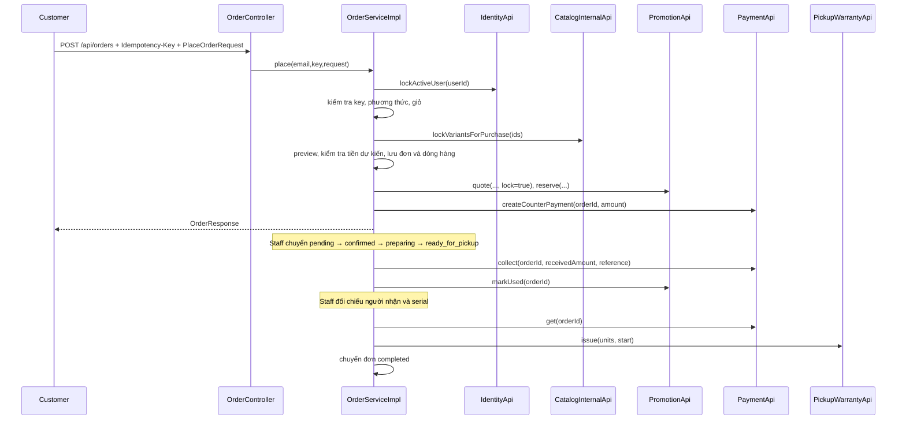
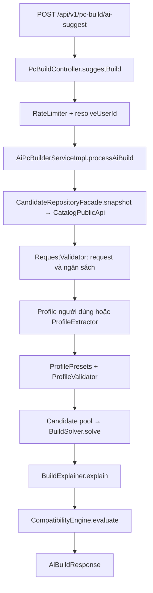
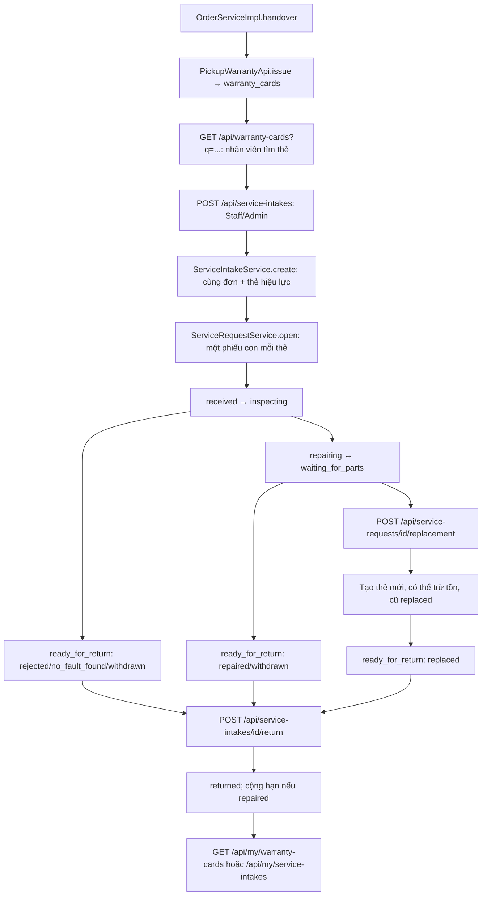

# Hướng dẫn đọc luồng và API backend CyberShop

Tài liệu mô tả source tại thời điểm 05/11/2026. Mục lục trong `module-reference/` được trích từ Java bằng tree-sitter: 288 file Java trong các package module/shared, 994 method/constructor được khai báo và 80 mapping HTTP được nhận diện. File khởi động ở root là `src/main/java/com/project/cybershop/CybershopApplication.java`. Tài liệu là phân tích tĩnh, không thay thế chạy thử hoặc chứng minh mọi nhánh hoạt động.

## Cách đọc và tìm hàm

1. Chọn module trong bảng dưới, tìm `HTTP endpoint` theo method/path, đọc chữ ký controller.
2. Trong chữ ký: `@PathVariable` lấy từ URL; `@RequestParam` từ query string; `@RequestHeader` từ header; `@RequestBody` là JSON body; `Authentication`/`Principal` do Spring cấp, không gửi trong body.
3. Kiểu sau `@RequestBody` là DTO request. Trong cùng tài liệu module, tìm tên DTO để thấy các trường và annotation validation; xem file Java để biết comment, kiểu lồng nhau và giá trị mặc định. Kiểu trả về trong chữ ký thể hiện response; `ResponseEntity<ApiResponseDTO<T>>` là response bọc `T`, trong khi một số controller trả DTO trực tiếp.
4. Xem phần `Lời gọi xuất hiện` trong thân controller để tìm service, sau đó tìm tên service hoặc implementation trong cùng file tra cứu. Danh sách lời gọi được trích theo cú pháp: có thể gồm getter/builder và lời gọi trong nhánh khác nhau; **không khẳng định thứ tự, mọi lời gọi đều chạy, hay đích runtime của interface**.
5. Các đường link trong bảng đưa đến file và dòng Java. Tìm implementation bằng tên interface; Spring inject implementation tương ứng. Với repository, xem entity, query và transaction để hiểu dữ liệu đọc/ghi. Cần kiểm tra cấu hình security và kiểm tra quyền trong service/controller trước khi dùng API.

| Module | Tra cứu chữ ký và endpoint | Vai trò |
|---|---|---|
| identity | [identity.md](module-reference/identity.md) | Đăng ký, đăng nhập, JWT, tài khoản; `IdentityApi` cho module khác. |
| catalog | [catalog.md](module-reference/catalog.md) | Sản phẩm, biến thể, thông số, tồn; cung cấp `CatalogInternalApi`, `CatalogPublicApi`. |
| order | [order.md](module-reference/order.md) | Giỏ, checkout, đơn và vận hành đơn. |
| payment | [payment.md](module-reference/payment.md) | `PaymentApi`: tạo/thu/hủy/tra cứu thanh toán tại quầy. Không có controller HTTP riêng trong module. |
| promotion | [promotion.md](module-reference/promotion.md) | Promotion/banner và giữ, sử dụng hoặc nhả voucher. |
| pcbuild | [pcbuild.md](module-reference/pcbuild.md) | Build thủ công, tương thích, đề xuất AI và lưu cấu hình. |
| aftersales | [aftersales.md](module-reference/aftersales.md) | Cấp và tra cứu thẻ, tiếp nhận, sửa/đổi và trả bảo hành. |
| review | [review.md](module-reference/review.md) | Đánh giá theo dòng đơn và tổng hợp đánh giá. |
| shared | [shared.md](module-reference/shared.md) | Security, JWT, response, exception và cấu hình dùng chung. |

## Sơ đồ quan hệ module



Mũi tên nét đứt thể hiện phụ thuộc vào chi tiết nội bộ/bảng, không phải API module. Không suy ra toàn bộ thứ tự thực thi từ sơ đồ quan hệ này.

## Luồng xác thực



- `register(RegisterRequest)` chuẩn hóa email, kiểm tra trùng, tạo user/role và giỏ; `login(LoginRequest)` nhận `identity` là email hoặc điện thoại và `password`.
- Request sau đó dùng `Authorization: Bearer <token>` khi endpoint yêu cầu đăng nhập. `JwtAuthenticationFilter` đưa thông tin vào security context; controller/service tiếp tục kiểm tra vai trò theo từng chức năng.
- Ví dụ body đăng nhập: `{"identity":"user@example.com","password":"matkhau"}`. Endpoint và field thực tế xem [identity.md](module-reference/identity.md).

## Luồng danh mục, giỏ và checkout



`CheckoutValidateRequest.itemVariantIds` cho phép truyền danh sách biến thể chọn mua; controller chấp nhận body không có. Preview nhận `CheckoutDetailsRequest`. Giá/tồn và khuyến mãi được kiểm tra lại khi tạo đơn, vì preview không giữ hàng. Kiểu response và các trường DTO nằm trong [order.md](module-reference/order.md).

## Tạo đơn, thanh toán và bàn giao



Thứ tự thực tế trong `place`: khóa user → kiểm tra đơn theo key → khóa variants → preview → quote → lưu đơn/dòng hàng → reserve → tạo payment → dọn các dòng giỏ đã mua. Sơ đồ gom bước để dễ đọc. Mỗi lần tạo đơn gửi `Idempotency-Key` dạng UUID. Ví dụ tối thiểu theo record `PlaceOrderRequest`:

```json
{"pickupName":"Nguyen Van A","pickupPhone":"0901234567","note":"","promotionCode":null,"method":"store","paymentMethodId":null,"expectedTotal":1000000,"expectedDiscount":0,"itemVariantIds":[1]}
```

Số tiền và ID chỉ là ví dụ; phải lấy giá/giảm giá hợp lệ từ preview, không tự coi chúng là dữ liệu thực tế. `expectedTotal` và `expectedDiscount` được đối chiếu lại khi đặt. Hiện `method` được triển khai là `store`. Gửi bàn giao bằng `HandoverRequest` gồm `recipientPhone`, `recipientVerified`, `devices` với mỗi thiết bị có `orderItemId`, `serialNumber`. Xem đầy đủ endpoint vận hành và DTO trong [order.md](module-reference/order.md).

Hủy đơn đi qua `OrderServiceImpl.cancel`: kiểm tra quyền/trạng thái → `PaymentApi.cancel` → hoàn tồn qua catalog → nhả promotion → `canceled`. Các điều kiện chi tiết nằm trong implementation.

## Luồng promotion, payment và review

- Promotion: `PromotionController` → `PromotionServiceImpl`. `quote(userId, code, total, lock)` tính giảm; order gọi `reserve(quote,userId,orderId,paid)`, `markUsed(orderId)` khi thu, `release(orderId)` khi hủy. Các hàm này là Java API nội bộ, không phải URL HTTP.
- Payment: `OrderServiceImpl` → `PaymentApi.createCounterPayment(orderId,amount)`, `collect(orderId,receivedAmount,reference)`, `get(orderId)`, `cancel(orderId)` → `PaymentServiceImpl`. `PaymentApi.Payment` trả `status`, `methodType`, `amount`, `paidAt`.
- Review: `PUT /api/order-items/{itemId}/review` → `ReviewServiceImpl`, kiểm tra chủ đơn và điều kiện hoàn tất → repository; `GET /api/products/{variantId}/reviews` đọc đánh giá. `CatalogServiceImpl` lấy tóm tắt qua `ReviewApi.productSummaries()`.

## Luồng build PC



`GET /options` lấy dữ liệu form; `POST /validate` kiểm tra cấu hình; `POST /compatible-replacements` và `/peripherals` gợi ý linh kiện thay thế/ngoại vi. `POST /save`, `GET /my-builds`, `GET /{buildId}`, `DELETE /{buildId}` liên quan cấu hình đã lưu và yêu cầu đăng nhập theo security/controller. Mỗi request/response được liệt kê tại [pcbuild.md](module-reference/pcbuild.md); bộ chọn hoạt động trên snapshot và giá/linh kiện phía server.

## Luồng bảo hành chi tiết



- `POST /api/service-intakes` nhận `IntakeCreateRequest`: `warrantyCardIds`, tùy chọn `outOfWarrantyCardIds`, `issueDescription`, `conditionNote`, `accessoriesNote`, `contactName`, `contactPhone`, `expectedReturnDate`. Thẻ ngoài bảo hành là nhận kèm, không tạo phiếu con.
- `POST /api/service-requests/{id}/transitions` nhận `TransitionRequest`: `toStatus`, `resolution` nếu bước yêu cầu, `internalNote`, tùy chọn `publicNote`, `expectedReturnDate`, `version`. Quyền và các chuyển trạng thái nằm trong `TransitionPolicy`.
- `POST /api/service-requests/{id}/replacement` nhận `ReplacementRequest`: `newSerialNumber`, `source` là `stock` hoặc `supplier`, `internalNote`, `publicNote`. Từ `stock` sẽ trừ tồn; transaction thất bại sẽ rollback các thay đổi liên quan.
- `POST /api/service-intakes/{id}/return` trả cả lần tiếp nhận, khi tất cả phiếu con đã chờ trả hoặc hủy và còn ít nhất một phiếu chờ trả. Khách xem nội dung công khai qua `/api/my/...`.

Ví dụ chuyển `received` sang `inspecting` (Technician/Admin; `version` lấy từ phiếu đang xem):

```json
{"toStatus":"inspecting","resolution":null,"internalNote":"Bắt đầu kiểm tra","publicNote":null,"expectedReturnDate":null,"version":0}
```

Các ID, trạng thái và version chỉ là ví dụ. Xem [aftersales.md](module-reference/aftersales.md) cho toàn bộ endpoint, các DTO và lời gọi, và xem `TransitionPolicy`, `ServiceIntakeService`, `ServiceRequestService`, `WarrantyRules` để biết nhánh đầy đủ.

## Các interface Java dùng giữa module

| Interface | Các method khai báo | Nơi dùng chính |
|---|---|---|
| `IdentityApi` | `lockActiveUser`, `requireActiveUser`, `getUserById`, `getUserByEmail`, `existsById` | order, aftersales, promotion, review, pcbuild |
| `CatalogInternalApi` | `isVariantInStock`, `deductStock`, `restoreStock`, `getVariantDetail`, `lockVariantsForPurchase`, `getPurchaseVariant`, `findActiveVariant` | order và aftersales |
| `CatalogPublicApi` | `getActiveCandidatesForBuild`, `getCandidateMapByIds`, `getCandidatesByIds`, `getSpecificationCatalog`, `getAllBrandNames` | pcbuild |
| `PromotionApi` | `quote`, `reserve`, `markUsed`, `release` | order |
| `PaymentApi` | `createCounterPayment`, `get`, `collect`, `cancel` | order |
| `PickupWarrantyApi` | `issue`, `forCustomer` | order và controller tra cứu bảo hành |
| `ReviewApi` | `productSummaries` | catalog |

Đây là contract Java dùng trong cùng ứng dụng. Chữ ký tham số và kiểu trả về cụ thể nằm trong tài liệu module và file interface tương ứng.

## Giới hạn của bản tra cứu

- Chữ ký và lời gọi được trích tự động, không phân giải overload, dispatch động, method reference, lời gọi do framework hoặc Lombok sinh. Repository Spring Data có thể tạo implementation lúc runtime; getter/setter Lombok có thể không xuất hiện như khai báo method trong source.
- Tên endpoint được suy ra từ các annotation mapping hiện diện trong controller; đối chiếu source và OpenAPI khi cần contract chính xác. Quyền không thể kết luận chỉ từ danh sách endpoint.
- Graphify trước đó báo cạnh thiếu/gộp; bản này ưu tiên source trực tiếp. Chưa chạy test end-to-end hoặc kiểm tra database thực tế; các ví dụ chỉ minh họa cấu trúc.
