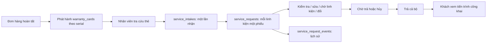

# Phân tích chức năng bảo hành và xử lý sau bán hàng

Tài liệu đọc từ mã nguồn trong workspace ngày 08/11/2026. Đây là mô tả mã hiện tại, không khẳng định schema trên cơ sở dữ liệu đang chạy đã được cập nhật hoặc mọi luồng đã được kiểm thử thực tế. Các tài liệu cũ trong DB có thể mô tả phiên bản trước. Module hiện thể hiện quy trình tiếp nhận, kiểm tra, sửa và đổi thiết bị; không thấy một module lịch bảo trì định kỳ riêng trong phạm vi này.

## 1. Sơ đồ tổng thể



FE component → `createWarrantyApi` → Axios/JWT → controller → `CurrentUser` kiểm tra tài khoản và vai trò → service/transaction → repository/JPA hoặc SQL → DTO → `ApiResponseDTO`. Liên kết chính: `warranty_cards.order_item_id → order_items.order_id → orders.user_id`; `service_intakes.order_id → orders.id`; `service_requests.intake_id → service_intakes.id`, `warranty_card_id → warranty_cards.id`; `service_request_events.service_request_id → service_requests.id`. Các ID liên quan nhân viên, kỹ thuật và khách trỏ tới `users`. `OrderLookup` join thêm `product_variants` để lấy phiên bản, SKU và thông tin kho.

## 2. Schema: từng trường và mục đích

Schema chuẩn trong `DB/scriptDB/SBA301-scriptDB.sql`, migration cho DB cũ trong `DB/scriptDB/aftersales-migration.sql`. Phải đối chiếu trạng thái migration thực tế trước khi áp dụng; script mẫu `DB/init_data/aftersales-sample.sql` ghi rõ không chạy trên DB chính.

### warranty_cards — một serial/một thẻ

| Cột | Chức năng |
|---|---|
| id | Khóa chính. |
| order_item_id | Dòng hàng đã mua, FK `order_items`. |
| serial_number | Serial của thiết bị, bắt buộc, unique; không phải `product_variants.serial_code` là SKU phiên bản. |
| replaces_card_id | FK thẻ cũ nếu thiết bị này được cấp thay thế; unique. |
| start_date, end_date | Ngày bắt đầu/kết thúc; code tính hiệu lực theo ngày, bao gồm cả ngày cuối. |
| status | Code dùng `active`, `void`, `replaced`; hết hạn tính từ ngày, không tự chuyển status thành expired. Comment SQL cũ có nhắc expired. |

### service_intakes — một lần mang cả bộ tới

`id` khóa chính; `intake_code` mã duy nhất dạng `BH-yyMMdd-XXXXXX`; `order_id` đơn của cả bộ; `user_id` chủ đơn; `created_by` nhân viên tạo; `created_at` ngày nhận; `returned_at` lúc trả cả bộ; `version` phục vụ optimistic locking. Thông tin người mang, tình trạng, phụ kiện được lưu ở từng phiếu con, không nằm trong bảng này.

### service_requests — một linh kiện trong lần tiếp nhận

| Cột | Chức năng |
|---|---|
| id, request_code | Khóa chính và mã phiếu con duy nhất, ví dụ mã lần nhận cộng `-01`. |
| user_id, intake_id, warranty_card_id | Chủ đơn, lần tiếp nhận, thẻ đang được gắn. Khi xác định sai linh kiện có thể đổi thẻ trong lúc inspecting. |
| issue_description | Mô tả lỗi khách báo. |
| condition_note, accessories_note | Ngoại quan và phụ kiện giữ lại. |
| contact_name, contact_phone | Người mang và số liên hệ, có thể khác chủ đơn. |
| assigned_technician_id | Kỹ thuật viên bắt đầu kiểm tra hoặc người thêm linh kiện trong lúc kiểm tra. |
| status, resolution | Giai đoạn và kết quả; là hai khái niệm riêng. |
| expected_return_date | Ngày hẹn trả dự kiến. |
| technician_note, public_note | Ghi chú mới nhất nội bộ và công khai; lịch sử từng lần ở bảng events. |
| created_at, completed_at | Thời điểm nhận và thời điểm chuyển chờ trả; completed_at không phải thời điểm trả thực tế. |
| version | Phiên bản optimistic lock để phát hiện cập nhật đồng thời. |

### service_request_events — nhật ký

`id`; `service_request_id`; `actor_id` người thao tác; `event_type` code thực tế tạo `CREATED`, `STATUS_CHANGED`, `NOTE_UPDATED`; `from_status`, `to_status`; `internal_note`, `public_note`; `created_at`. Nhật ký được thêm khi mở phiếu, chuyển trạng thái, thêm ghi chú, đổi thẻ hoặc đổi thiết bị. Khách chỉ nhận nội dung công khai.

Index `uq_service_requests_open_card` là unique có điều kiện `status NOT IN ('returned','canceled')`: một thẻ tối đa một phiếu mở. DB còn có unique mã phiếu, mã lần nhận, serial và thẻ thay thế; CHECK status/resolution; index `intake_id`, index lịch sử theo phiếu/ngày. Cần có index này trong DB thực tế để chặn tạo trùng đồng thời, kiểm tra service đơn lẻ không đủ.

## 3. Trạng thái và kết quả

| status | Nghĩa |
|---|---|
| received | Đã nhận, chưa kiểm tra. |
| inspecting | Kỹ thuật đang kiểm tra. |
| repairing | Đang sửa theo bảo hành. |
| waiting_for_parts | Chờ linh kiện. |
| ready_for_return | Đã xử lý, chờ trả. |
| returned | Đã trả cả bộ. |
| canceled | Đã hủy. |

`resolution`: `repaired` đã sửa; `replaced` đổi thiết bị; `rejected` từ chối; `no_fault_found` không tìm thấy lỗi; `withdrawn` khách rút. Code lưu dạng chữ thường; `JpaConverter` đổi với enum Java.

| Từ → đến | Vai trò | Kết quả được phép |
|---|---|---|
| received → inspecting | TECHNICIAN | Không có |
| received → canceled | STAFF | Không có |
| inspecting → repairing | TECHNICIAN | Không có, phải còn bảo hành lúc nhận |
| inspecting → ready_for_return | TECHNICIAN | rejected, no_fault_found, withdrawn |
| inspecting → canceled | TECHNICIAN | Không có |
| repairing → ready_for_return | TECHNICIAN | repaired, withdrawn |
| repairing → waiting_for_parts / inspecting | TECHNICIAN | Không có |
| waiting_for_parts → repairing / ready_for_return | TECHNICIAN | Không có / withdrawn |
| ready_for_return → inspecting | STAFF | Không có; không áp dụng khi đã đổi thiết bị |
| ready_for_return → returned | STAFF | Chỉ thực hiện thông qua trả cả intake |

ADMIN được phép thay các vai trò trên. `TransitionPolicy.check` kiểm tra cạnh, vai trò và resolution; `ServiceRequestService.move` kiểm tra thêm thời hạn và các điều kiện khác. Trạng thái intake được suy ra từ phiếu chưa hủy có thứ tự enum nhỏ nhất; nếu tất cả hủy thì canceled. Trả cả bộ khi tất cả là ready_for_return/canceled và có ít nhất một phiếu ready_for_return.

## 4. Danh sách 16 HTTP API trực tiếp

`S` = STAFF, `T` = TECHNICIAN, `A` = ADMIN, `U` = người dùng đang đăng nhập. Danh sách dựa trên 5 controller trong package aftersales, không tính API đơn hàng, catalog hoặc các lời gọi Java nội bộ. Hầu hết trả `{status,message,data}`; GET `/api/me/warranties` trả list trực tiếp. HTTP tạo intake là 201 nhưng `ApiResponseDTO.success` đặt trường `status` trong body là 200.

| # | Method và đường dẫn | Quyền | Input → mục đích/kết quả |
|---|---|---|---|
| 1 | GET `/api/warranty-cards?q=...` | S,T,A | `q` khớp chính xác serial, mã đơn, điện thoại chủ đơn hoặc nhận hàng, mã phiếu hoặc mã intake; trả thẻ của cả đơn, thẻ trùng trực tiếp có `matched=true`. Có gọi đồng bộ thẻ thiếu trước tra cứu. |
| 2 | POST `/api/service-intakes` | S,A | `IntakeCreateRequest` → tạo intake và các phiếu con; trả `ServiceIntakeDto`, HTTP 201. |
| 3 | GET `/api/service-intakes/{id}` | S,T,A | id intake → chi tiết, các phiếu, cờ thao tác. |
| 4 | POST `/api/service-intakes/{id}/return` | S,A | `NoteRequest` → trả tất cả linh kiện đủ điều kiện, cộng hạn các phiếu repaired, set `returned_at`. |
| 5 | POST `/api/service-intakes/{id}/cancel` | S,A | `NoteRequest` → hủy cả lần nếu các phiếu chỉ received/canceled và còn ít nhất một received. |
| 6 | POST `/api/service-intakes/{id}/requests` | T,A | `RelinkCardRequest` → thêm thẻ cùng đơn khi intake còn mở; phiếu mới bắt đầu inspecting. |
| 7 | POST `/api/service-intakes/{id}/no-fault-rest` | T,A | `NoFaultComponentsRequest` → xác nhận các phiếu được chọn không có lỗi; kiểm tra version và trạng thái, chuyển inspecting nếu cần rồi ready_for_return/no_fault_found. |
| 8 | GET `/api/service-requests?status=...` | S,T,A | status tùy chọn → danh sách summary; hiện không phân trang. |
| 9 | GET `/api/service-requests/{id}` | S,T,A | Chi tiết phiếu, thẻ, sự kiện, `allowedTransitions`, các cờ thao tác. |
| 10 | POST `/api/service-requests/{id}/transitions` | S,T,A tùy bước | `TransitionRequest` → chuyển theo policy; không cho chuyển returned trực tiếp. |
| 11 | POST `/api/service-requests/{id}/notes` | T,A | `NoteRequest` → ghi chú ở inspecting/repairing/waiting_for_parts, không chuyển trạng thái. |
| 12 | PUT `/api/service-requests/{id}/warranty-card` | T,A | `RelinkCardRequest` → đổi thẻ khi inspecting; thẻ mới active, cùng đơn, chưa có phiếu mở. |
| 13 | POST `/api/service-requests/{id}/replacement` | T,A | `ReplacementRequest` → đổi serial trong repairing, tạo thẻ mới, thẻ cũ replaced, phiếu ready_for_return/replaced; nguồn stock trừ một tồn, supplier không trừ. |
| 14 | GET `/api/my/warranty-cards` | U | Lấy thẻ của chủ đơn đang đăng nhập, lịch sử công khai. |
| 15 | GET `/api/my/service-intakes` | U | Lấy những lần tiếp nhận của người đang đăng nhập, các linh kiện và timeline công khai. |
| 16 | GET `/api/me/warranties` | U | Danh sách thẻ thuộc user từ `PickupWarrantyServiceImpl.forCustomer`; response là list record `Card`, khác định dạng hai API `/api/my`. |

### Các body đầu vào

* `IntakeCreateRequest`: `warrantyCardIds` bắt buộc là list ID còn hiệu lực, có thể rỗng nếu có list ngoài hạn; `outOfWarrantyCardIds` tùy chọn chứa thẻ active đã hết hạn; `issueDescription`, `conditionNote`, `accessoriesNote`, `contactName` bắt buộc không trắng; tên tối đa 100 ký tự; `contactPhone` đúng 10 số, bắt đầu 0; `expectedReturnDate` ngày ISO `yyyy-MM-dd`, không trước hôm nay. Hai nhóm phải cùng một đơn, không rỗng tổng thể; ID trùng bị loại. Ngoài hạn vẫn tạo phiếu con để kiểm tra, không được chuyển sửa bảo hành.
* `NoteRequest`: `internalNote` bắt buộc; `publicNote`, `expectedReturnDate` tùy chọn. Ngày mới khi được áp dụng không trước hôm nay. API return/cancel chỉ dùng hai note, không dùng expectedReturnDate.
* `RelinkCardRequest`: `warrantyCardId` bắt buộc, `internalNote` bắt buộc.
* `NoFaultComponentsRequest`: `components` không rỗng, mỗi phần tử `{id,version}` bắt buộc; `internalNote` bắt buộc; `publicNote` tùy chọn, bỏ trống dùng câu mặc định.
* `TransitionRequest`: `toStatus`, `internalNote` bắt buộc; `resolution`, `publicNote`, `expectedReturnDate`, `version` tùy chọn trong DTO. Service yêu cầu publicNote khi chuyển ready_for_return và resolution đúng cạnh; nên gửi `version` nhận từ GET để phát hiện dữ liệu cũ.
* `ReplacementRequest`: `newSerialNumber` không trắng, tối đa 100; `source` là `stock` hoặc `supplier`; `internalNote`, `publicNote` không trắng. Serial được trim và chuyển chữ hoa, kiểm tra trùng không phân biệt hoa thường.

Ví dụ tạo:

```json
{"warrantyCardIds":[101,102],"outOfWarrantyCardIds":[103],"issueDescription":"Máy tự tắt","conditionNote":"Vỏ xước nhẹ","accessoriesNote":"Dây nguồn","contactName":"Nguyễn An","contactPhone":"0912345678","expectedReturnDate":"2026-12-01"}
```

Ví dụ chuyển phiếu: `{"toStatus":"ready_for_return","resolution":"repaired","internalNote":"Đã thay linh kiện lỗi","publicNote":"Thiết bị đã sửa xong","version":1}`. Đây chỉ hợp lệ nếu hiện đang `repairing`, đúng quyền và còn bảo hành lúc nhận. Giá trị ID/ngày/version phải thay theo dữ liệu thực.

## 5. Dữ liệu trả về

* `WarrantyCardDto`: id, orderItemId, serialNumber, startDate/endDate, warrantyRemainingDays/warrantyRemainingAsOf, status/valid, productName/variantName/sku, orderCode/orderId/pcCustomId, matched, customerName/customerPhone/pickupName/pickupPhone, replacesCardId/replacedByCardId/replacedBySerialNumber/replacedByEndDate, repairedCount, openRequest và requests. Hạn hiển thị có thể là hạn dự kiến sau sửa trong khi chưa ghi vào thẻ.
* `ServiceIntakeDto`: id/intakeCode, orderId/orderCode/customerName, status, contactName/contactPhone, issueDescription/conditionNote/accessoriesNote, expectedReturnDate, createdAt/returnedAt/version, requests và canReturn/canCancel/canAddComponent.
* `ServiceRequestSummaryDto`: id/version/requestCode/intakeId/intakeCode, status/resolution, issueDescription/contactName/contactPhone, expectedReturnDate/createdAt/completedAt, warrantyCardId/pcCustomId, underWarrantyAtIntake/serialNumber/warrantyStartDate/warrantyEndDate/warrantyRemainingDays/warrantyRemainingAsOf, replacementSerialNumber/replacementWarrantyEndDate/replacementWarrantyRemainingDays, productName/orderCode.
* `ServiceRequestDto`: thông tin phiếu và liên hệ, ghi chú nội bộ/công khai, kỹ thuật viên, thời gian, version; thêm `card`, `events`, `allowedTransitions` gồm `toStatus` và `resolutions`, các cờ `canAddNote`, `canRelinkCard`, `canReplaceDevice`, `replacementInStock`.
* `MyWarrantyCardDto`: id, serialNumber, startDate/endDate, status/valid, productName/pcCustomId/variantName/orderCode, replacedBySerialNumber, requests. `MyServiceIntakeDto`: intakeCode/orderCode/status/issueDescription/expectedReturnDate/createdAt/returnedAt/components. Mỗi `MyServiceRequestDto` có thông tin sản phẩm, serial, thời hạn, thay thế, status/resolution, mô tả, publicNote, ngày, timeline công khai; không có technicianNote/internalNote.
* `ServiceRequestEventDto`: id, fromStatus/toStatus, actorId/actorName, internalNote/publicNote, createdAt. Timeline khách chỉ có status, publicNote, createdAt.

Các định nghĩa đầy đủ về kiểu và trường nằm trong `src/main/java/com/project/cybershop/aftersales/api/dto/response/`.

## 6. Luồng chi tiết và các hàm liên kết

### Phát hành thẻ từ đơn hàng

`OrderServiceImpl` gọi `validateWarrantyDevices` kiểm tra danh sách serial rồi gọi `PickupWarrantyApi.issue`; `PickupWarrantyServiceImpl.issue` kiểm tra trùng serial bằng SQL và INSERT thẻ active, start là thời điểm bàn giao, end = start cộng số tháng của dòng hàng. Code còn gọi issue trong nhánh hoàn thành đơn giao hàng. Xem chính xác điều kiện từng nhánh trong `OrderServiceImpl` quanh các dòng 326, 464, 551. Đây là API Java nội bộ, không phải endpoint HTTP phát hành thẻ.

`WarrantyCardService.syncMissingCards` còn quét các dòng của đơn `completed` có số tháng > 0 nhưng chưa có thẻ nào, sinh serial dạng `SN-GHN-...` hoặc `SN-TZ-...` theo loại giao hàng, số lượng và ngày cập nhật đơn; được gọi từ `search` và `myCards`. Hàm bắt exception và in stderr. Đây là thao tác ghi phát sinh khi tra cứu, có thể tạo serial tổng hợp; không nên mặc định hiểu serial đó là serial vật lý. Điều kiện kiểm tra là chưa có *bất kỳ* thẻ nào cho dòng hàng, không kiểm tra còn thiếu một phần số lượng.

### Tạo và xử lý lần tiếp nhận

`ServiceIntakeController.create` → `CurrentUser.require` → `ServiceIntakeService.create`: xác thực ngày hẹn, gộp ID, `OrderLookup.byCardIds` kiểm tra cùng đơn, `requestService.card` lấy thẻ, `WarrantyRules.isValidOn` kiểm tra nhóm trong hạn, kiểm tra nhóm ngoài hạn là active và đã hết hạn. Tạo intake lấy chủ từ đơn, không nhận userId từ client. Với từng thẻ: `child` tạo mã/quan hệ, sao chép thông tin chung, gọi `ServiceRequestService.open` kiểm tra phiếu mở → `save` → `log` sự kiện CREATED. Toàn bộ nằm trong transaction.

`get` → `load` + `detail`; `parts` lấy phiếu con; `statuses`, `WarrantyRules.intakeStatus` tính trạng thái; `cardService.summaries` làm danh sách; `detail` xác định cờ theo vai trò và trạng thái. `cancel` kiểm tra `canCancel` rồi `move` từng phiếu received sang canceled. `returnAll` kiểm tra `WarrantyRules.canReturn`, `move` từng phiếu ready_for_return sang returned và ghi returnedAt. `addComponent` xác minh intake còn mở, thẻ cùng đơn, active và đã bắt đầu tại ngày nhận, sao chép dữ liệu phiếu đầu, dùng ngày nhận của intake, gán người đang thao tác và `open` phiếu inspecting. `noFaultRest` kiểm tra từng id/version và received hoặc inspecting trước khi cập nhật từng phiếu qua `move`; ghi public note mặc định nếu thiếu.

### Xử lý một phiếu

`ServiceRequestService.list` lọc status, gọi `cardService.summaries`; `get` gọi `load` → `detail`. `transition` kiểm tra version nếu có, parse status/resolution, từ chối returned trực tiếp rồi `move`. `move` gọi `TransitionPolicy.check`, lấy thẻ, kiểm tra điều kiện sửa trong hạn, chặn kiểm tra lại phiếu đã đổi, bắt buộc publicNote khi chờ trả; gán kỹ thuật viên khi nhận kiểm tra; ghi resolution/completedAt khi chờ trả; xóa hai trường này khi kiểm tra lại; khi trả và resolution repaired thì cộng số ngày từ ngày nhận đến ngày sửa xong vào endDate; `apply` cập nhật ghi chú/ngày hẹn → `save` → `log`.

`addNote` chỉ cho ba trạng thái đang xử lý; `relinkCard` kiểm tra inspecting, thẻ khác, active, cùng đơn, không có phiếu mở rồi cập nhật và log. `replaceDevice` kiểm tra repairing và thẻ còn hiệu lực lúc nhận; chuẩn hóa và kiểm tra serial, tạo thẻ mới cùng orderItem, trỏ thẻ cũ; hạn mới = hạn cũ + số ngày từ nhận đến đổi, không tính lại toàn bộ số tháng; nếu stock thì `CatalogInternalApi.deductStock(variantId,1)`; đổi status thẻ cũ, set phiếu ready_for_return/replaced/completedAt rồi log. Các bước ghi cùng transaction, lỗi sẽ rollback.

Hàm phụ: `load`/`card` báo không tìm thấy; `orderInfo` đòi quan hệ đơn hợp lệ; `receivedDay` lấy ngày nhận; `blankToNull` chuẩn hóa ghi chú; `reinspectsReplaced` chặn kiểm tra lại thẻ cũ đã đổi; `apply` giữ ghi chú mới nhất và kiểm tra ngày hẹn; `save` chuyển lỗi optimistic lock và unique index thành lỗi nghiệp vụ; `log` tạo event; `detail` dùng `AftersalesMapper`, lấy thẻ/lịch sử/tên người thao tác từ `IdentityApi`, áp policy để trả allowedTransitions và kiểm tra tồn thay thế qua catalog. Lưu ý cờ `canReplaceDevice` dựa trên vai trò và status, còn `replaceDevice` vẫn kiểm tra hiệu lực khi gọi thật.

### Tra cứu, lịch sử và tính ngày

`WarrantyCardService.search` → `syncMissingCards` → `OrderLookup.searchCardIds` → `byCardIds` → `cardIdsOfOrders` → `toDtos`. `toDtos` gom đơn, phiếu, thẻ thay thế, tính `matched`, `repairedCount`, phiếu mở và hạn hiển thị; `summaries` tạo danh sách rút gọn. `myCards` tìm card theo user qua đơn và chỉ giữ phiếu của user; `myIntakes` lấy intake theo user, nhóm phiếu con. `myRequests` map sang DTO khách, bỏ những dòng event chỉ có nội dung nội bộ và giữ status/publicNote cho các dòng còn lại. `requestsByCard`, `replacedBy`, `intakeCodes`, `summary` là các bước gom/ghép dữ liệu.

`WarrantyRules.now` dùng Asia/Ho_Chi_Minh; `wasCoveredOn` so sánh ngày bắt đầu/kết thúc bao gồm biên, `isValidOn` kiểm tra thêm active; `extensionDays` lấy chênh lệch ngày nhận đến ngày hoàn tất, tối thiểu 0; `newRequestCode` sinh mã ngẫu nhiên, `childCode` thêm số thứ tự; `normalizeSerial` trim và uppercase. `remainingAsOf` lấy ngày nhận trong khi phiếu còn đang xử lý trước ready_for_return, nếu không lấy hôm nay; `effectiveWarrantyEnd` tạm hiển thị hạn đã cộng khi đã repaired/chờ trả, tới khi trả mới ghi vào thẻ; `remainingDays` không âm.

## 7. FE gọi API như thế nào

`FE/src/routes/AppRoutes.jsx`: `/van-hanh/bao-hanh` tiếp nhận, `/ky-thuat` kỹ thuật, `/bao-hanh` khách. `features/warranty/components/LiveSwitch.jsx` chọn component API hoặc demo theo `VITE_USE_DEMO_DATA === 'true'` trong `utils/runtime.js`. Chạy demo thì thao tác không chứng minh BE/DB hoạt động.

Ở chế độ live: `ApiWarrantyIntake.jsx`, `ApiTechnicianWorkbench.jsx`, `ApiCustomerWarranty.jsx` gọi `features/warranty/api/warrantyApi.js`; file này ánh xạ endpoint trong `services/endpoints.ts`. `axiosClient.ts` lấy base URL từ `VITE_API_BASE_URL`, mặc định `http://localhost:8080`, tự gắn `Authorization: Bearer <techzone-token>` từ sessionStorage; wrapper lấy `response.data.data` nếu có, gọi xử lý hết phiên khi 401. Quyền thực sự vẫn kiểm tra tại BE. Có thể mở tab Network của trình duyệt để xem method, URL, request payload, response của từng thao tác.

Thử bằng công cụ HTTP với token phù hợp: `GET http://localhost:8080/api/warranty-cards?q=SERIAL`, header `Authorization: Bearer <token>`. Lấy ID từ `data`, POST tạo intake với `Content-Type: application/json`; GET intake lấy ID phiếu; đăng nhập technician và GET phiếu lấy `version`, sau đó POST transitions. Sau khi các phiếu đã xong, đăng nhập staff POST return. Không dùng ID/token ví dụ để ghi vào dữ liệu thật khi chưa kiểm tra.

## 8. Các điểm cần chú ý khi đọc code

* `expectedReturnDate` là ngày hẹn, `completedAt` là lúc xử lý xong, `returnedAt` là lúc trả cả bộ; không đồng nhất ba thời điểm.
* `user_id` là chủ đơn; contact là người mang; tên và điện thoại dùng để tiếp nhận, không quyết định quyền sở hữu thẻ.
* Đổi thẻ (`relinkCard`) là sửa liên kết phiếu khi chẩn đoán; đổi thiết bị (`replacement`) tạo thẻ mới và vô hiệu hóa thẻ cũ bằng status replaced.
* Các phương thức ghi dùng transaction; `@Version` và unique index hỗ trợ đồng thời. Chỉ endpoint transition có version tùy chọn trong body; no-fault-rest bắt buộc version mỗi phần tử.
* Các tài liệu cũ có đoạn nói chỉ tạo thẻ mẫu, hết hạn không tạo phiếu hoặc cấp lại đủ tháng sau đổi: không phản ánh đầy đủ code hiện tại. Schema SQL và migration là file trong repo, không chứng minh DB đang chạy có đủ constraints.
* Module không tự tạo lịch bảo trì định kỳ, bảng giá sửa ngoài bảo hành hay thanh toán sửa chữa trong những controller/service đã phân tích.

## 9. Nơi xem mã và kiểm thử

* Controller: `src/main/java/com/project/cybershop/aftersales/internal/controller/`.
* Service và policy: `.../internal/service/ServiceIntakeService.java`, `ServiceRequestService.java`, `WarrantyCardService.java`, `TransitionPolicy.java`, `WarrantyRules.java`, `impl/PickupWarrantyServiceImpl.java`.
* Mapping và SQL: `.../internal/mapper/AftersalesMapper.java`, `.../internal/repository/OrderLookup.java`, các repository cùng thư mục.
* Bảng và kiểu Java: `.../internal/entity/`; DTO request/response: `.../api/dto/`.
* Tích hợp đơn hàng: `src/main/java/com/project/cybershop/order/internal/service/impl/OrderServiceImpl.java`.
* Các test hiện có: `src/test/java/com/project/cybershop/aftersales/` gồm test luật, thẻ, tiếp nhận và API ngoài hạn. Tên test là bằng chứng test tồn tại, không phải bằng chứng đã chạy thành công trong lần phân tích này.

Tài liệu này giải thích theo từng trường, hàm và luồng chính; không diễn giải từng dòng import, annotation hoặc getter Lombok. Muốn kiểm tra một trường cụ thể hãy mở định nghĩa DTO/entity và tìm tên trường trong service tương ứng.
